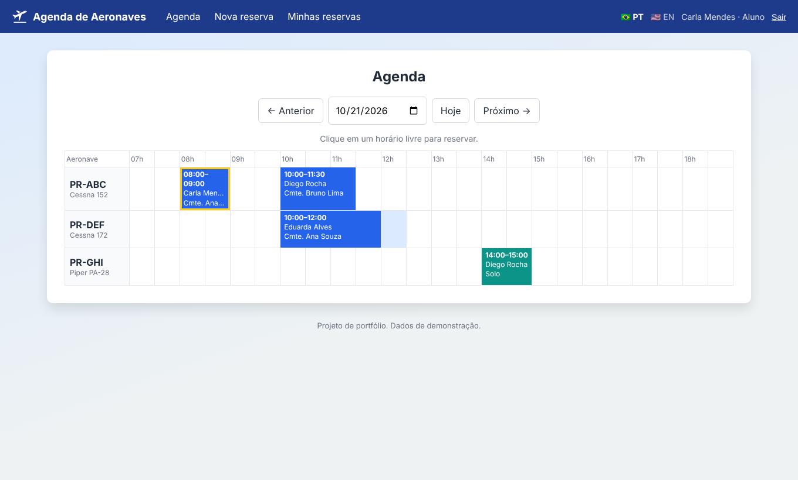
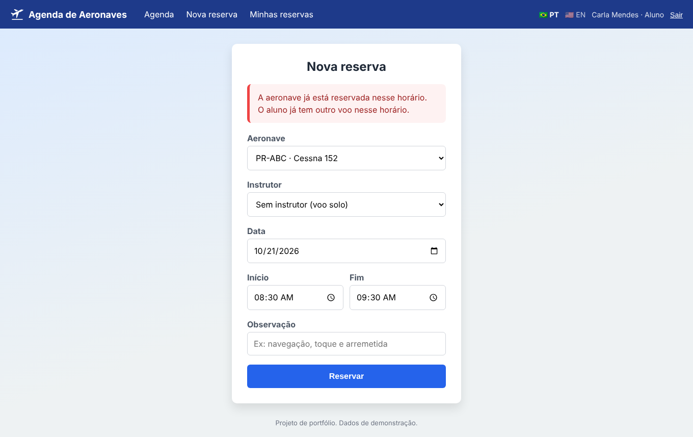

# ✈️ Agenda de Aeronaves · Aircraft Scheduling

🇧🇷 [Português](#-português) · 🇺🇸 [English](#-english)



## 🇧🇷 Português

Sistema web para aeroclubes e escolas de aviação organizarem o uso da frota: alunos e instrutores reservam horários de voo, e o sistema impede choques de horário.

### O que ele faz

- **Login** com três perfis: aluno, instrutor e administrador (secretaria).
- **Agenda do dia** em grade: uma linha por aeronave, blocos de 30 minutos. Clique num horário livre para reservar.
- **Reserva** com aeronave, aluno, instrutor (ou voo solo), início, fim e observação.
- **Bloqueio de conflitos**: a mesma aeronave, o mesmo instrutor ou o mesmo aluno não ficam em dois voos ao mesmo tempo.
- **Regras do aeroclube**: horário de funcionamento (07h às 19h), máximo de 4 horas por reserva, sem reservas no passado. Tudo configurável em `regras.py`.
- **Cancelamento** pelo próprio aluno, pelo instrutor do voo ou pela secretaria. O histórico fica guardado.
- **Administração**: cadastro de aeronaves (com opção de tirar da agenda durante a manutenção) e de usuários.
- **Bilíngue**: português e inglês, trocando com um clique.



### Tecnologias

Python, Flask, SQLAlchemy (SQLite no computador, PostgreSQL em produção), Flask-Login, senhas com hash (Werkzeug), proteção CSRF nos formulários e testes com pytest.

### Como rodar

```bash
pip install -r requirements.txt
python app.py
```

Abra http://127.0.0.1:5000 e entre com uma das contas de demonstração (senha `demo123`):

| E-mail | Perfil |
|---|---|
| admin@demo.com | Administrador |
| ana@demo.com | Instrutor |
| carla@demo.com | Aluno |

Para rodar os testes: `python -m pytest`

### Configuração

Copie `.env.exemplo` para `.env`. Variáveis:

- `SECRET_KEY`: frase secreta usada para proteger o login.
- `DATABASE_URL`: endereço do PostgreSQL. Sem ela, usa um arquivo SQLite local.
- `DEMO`: `1` cria dados de exemplo quando o banco está vazio; `0` começa limpo.

---

## 🇺🇸 English

A web app for flying clubs and flight schools to manage their fleet: students and instructors book flight slots, and the system prevents double bookings.

### Features

- **Sign in** with three roles: student, instructor and administrator (front desk).
- **Daily schedule** grid: one row per aircraft, 30-minute slots. Click a free slot to book it.
- **Bookings** with aircraft, student, instructor (or solo flight), start, end and a note.
- **Conflict checks**: the same aircraft, instructor or student can never be in two flights at once.
- **Club rules**: opening hours (07:00 to 19:00), 4 hours max per booking, no bookings in the past. All configurable in `regras.py`.
- **Cancellation** by the student, the flight's instructor or the front desk. History is kept.
- **Admin**: manage aircraft (take one off the schedule during maintenance) and users.
- **Bilingual**: Portuguese and English, switched with one click.

### Tech stack

Python, Flask, SQLAlchemy (SQLite locally, PostgreSQL in production), Flask-Login, hashed passwords (Werkzeug), CSRF protection on forms and pytest tests.

### Running it

```bash
pip install -r requirements.txt
python app.py
```

Open http://127.0.0.1:5000 and sign in with a demo account (password `demo123`): `admin@demo.com`, `ana@demo.com` (instructor) or `carla@demo.com` (student).

Run the tests with `python -m pytest`.

### Settings

Copy `.env.exemplo` to `.env`. `SECRET_KEY` protects sessions, `DATABASE_URL` points to PostgreSQL (SQLite is used when it is missing) and `DEMO=1` seeds sample data into an empty database.

---

Desenvolvido por / Built by [João Pedro Rodrigues](https://github.com/joaopedrorf)
