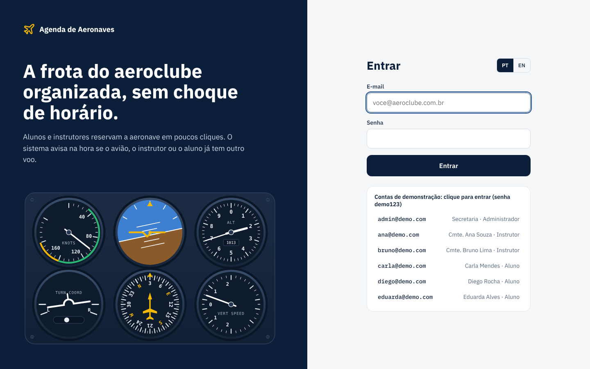
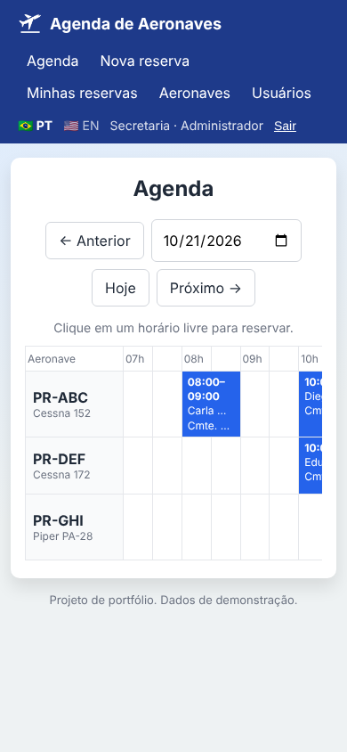

# ✈️ Agenda de Aeronaves · Aircraft Scheduling

[](https://github.com/joaopedrorf/agenda-aeronaves/actions/workflows/testes.yml)


🇧🇷 [Português](#-português) · 🇺🇸 [English](#-english)

**🌐 Ver online / Live demo: [agenda-aeronaves.onrender.com](https://agenda-aeronaves.onrender.com)** · senha / password `demo123`


## 🇧🇷 Português

Sistema web para aeroclubes e escolas de aviação organizarem o uso da frota: alunos e instrutores reservam horários de voo, e o sistema impede choques de horário.

### O que ele faz

- **Login** com três perfis: aluno, instrutor e administrador (secretaria).
- **Agenda do dia** em linha do tempo: uma linha por aeronave, blocos de 30 minutos. Clique num horário livre para reservar. Seu voo aparece em amarelo e o voo solo com borda tracejada.
- **Resumo do dia**: quantos voos, quantas horas reservadas, aeronaves disponíveis e o seu próximo voo.
- **Reserva** com aeronave, aluno, instrutor (ou voo solo), início, fim e observação.
- **Bloqueio de conflitos**: a mesma aeronave, o mesmo instrutor ou o mesmo aluno não ficam em dois voos ao mesmo tempo. Quando há choque, o sistema sugere o horário livre mais próximo e outras aeronaves livres no mesmo horário.
- **Quadro de disponibilidade** ao lado do formulário, mostrando os trechos livres e ocupados da aeronave escolhida.
- **Regras do aeroclube**: horário de funcionamento (07h às 19h), máximo de 4 horas por reserva, sem reservas no passado. Tudo configurável em `regras.py`.
- **Cancelamento** pelo próprio aluno, pelo instrutor do voo ou pela secretaria. O histórico fica guardado.
- **Administração**: cadastro de aeronaves (com opção de tirar da agenda durante a manutenção) e de usuários.
- **Bilíngue**: português e inglês, trocando com um clique.
- **Funciona no celular**: a agenda vira uma lista por aeronave, com faixa de dias e botão "Reservar" sempre à mão.

| Login | Conflito com sugestão | Celular |
|---|---|---|
|  |  |  |

### Tecnologias

Python, Flask, SQLAlchemy (SQLite no computador, PostgreSQL em produção), Flask-Login, senhas com hash (Werkzeug), proteção CSRF nos formulários e testes com pytest. O visual (azul-marinho, amarelo de aviação, fontes IBM Plex e a ilustração do painel de instrumentos em SVG) foi desenhado primeiro como protótipo e depois aplicado em HTML e CSS puros, sem framework.

### Segurança e dados

- **Onde ficam os dados**: usuários, aeronaves e reservas ficam num banco de dados (SQLite no computador, PostgreSQL em produção). Na demonstração online o banco é recriado a cada reinício, então nenhum dado real fica guardado.
- **Senhas**: nunca são guardadas como texto. O banco guarda só um *hash* (scrypt, via Werkzeug): dá para conferir se a senha digitada está certa, mas não dá para descobrir a senha a partir dele.
- **Login**: depois de 5 senhas erradas em 15 minutos, o acesso fica bloqueado por 15 minutos. A mensagem de erro é a mesma para e-mail inexistente e senha errada, para não revelar quem tem conta.
- **Sessão**: cookie protegido (`HttpOnly`, `SameSite=Lax` e `Secure` em produção), sessão nova a cada login e expiração em 8 horas.
- **Formulários**: todos têm token CSRF, que impede outro site de enviar ações em nome do usuário.
- **Permissões**: aluno só reserva para si; só a secretaria cadastra aeronaves e usuários; cada um só cancela os próprios voos.
- **Cabeçalhos de segurança**: Content-Security-Policy, X-Frame-Options e outros, contra páginas falsas e scripts de terceiros.
- **Fuso horário**: o servidor pode estar em outro país, mas todas as regras usam o horário do aeroclube (`FUSO_HORARIO`, padrão Brasília).

### Estrutura do projeto

| Arquivo | O que faz |
|---|---|
| `app.py` | Rotas e telas (login, agenda, reservas, administração) |
| `regras.py` | Regras de agendamento: conflitos, horários, sugestões, fuso |
| `modelos.py` | Tabelas do banco: usuário, aeronave, reserva |
| `seguranca.py` | Limite de tentativas de login e cabeçalhos de segurança |
| `textos.py` | Todos os textos em português e inglês |
| `demo.py` | Aeroclube fictício para a demonstração |
| `tests/` | 41 testes automáticos, que rodam no GitHub a cada envio |

### Como rodar

```bash
pip install -r requirements.txt
python app.py
```

Abra http://127.0.0.1:5000 e entre com uma das contas de demonstração (senha `demo123`):

| E-mail | Perfil |
|---|---|
| admin@demo.com | Administrador |
| ana@demo.com | Instrutor |
| carla@demo.com | Aluno |

Para rodar os testes: `python -m pytest`

### Configuração

Copie `.env.exemplo` para `.env`. Variáveis:

- `SECRET_KEY`: frase secreta usada para proteger o login.
- `DATABASE_URL`: endereço do PostgreSQL. Sem ela, usa um arquivo SQLite local.
- `DEMO`: `1` cria dados de exemplo quando o banco está vazio; `0` começa limpo.

### Publicar no Render

O arquivo `render.yaml` já traz a configuração: no Render, clique em **New > Blueprint** e escolha este repositório. O site usa os dados de demonstração, que voltam ao estado inicial a cada nova publicação.

---

## 🇺🇸 English

A web app for flying clubs and flight schools to manage their fleet: students and instructors book flight slots, and the system prevents double bookings.

### Features

- **Sign in** with three roles: student, instructor and administrator (front desk).
- **Daily timeline**: one row per aircraft, 30-minute slots. Click a free slot to book it. Your flights show in yellow, solo flights with a dashed border.
- **Day summary**: number of flights, hours booked, aircraft available and your next flight.
- **Bookings** with aircraft, student, instructor (or solo flight), start, end and a note.
- **Conflict checks**: the same aircraft, instructor or student can never be in two flights at once. On a clash, the app suggests the closest free time and other aircraft free at the same time.
- **Availability panel** next to the form, listing the chosen aircraft's free and booked periods.
- **Club rules**: opening hours (07:00 to 19:00), 4 hours max per booking, no bookings in the past. All configurable in `regras.py`.
- **Cancellation** by the student, the flight's instructor or the front desk. History is kept.
- **Admin**: manage aircraft (take one off the schedule during maintenance) and users.
- **Bilingual**: Portuguese and English, switched with one click.
- **Mobile friendly**: on a phone the schedule becomes a list per aircraft, with a day strip and a floating "Book" button.

### Tech stack

Python, Flask, SQLAlchemy (SQLite locally, PostgreSQL in production), Flask-Login, hashed passwords (Werkzeug), CSRF protection on forms and pytest tests. The look (navy, aviation yellow, IBM Plex fonts and an SVG instrument panel illustration) was prototyped first and then built in plain HTML and CSS, with no framework.

### Security and data

- **Where data lives**: users, aircraft and bookings are stored in a database (SQLite locally, PostgreSQL in production). The online demo database is rebuilt on every restart, so no real data is kept.
- **Passwords** are never stored as text, only as a scrypt hash (Werkzeug).
- **Sign-in**: 5 wrong passwords in 15 minutes lock the account for 15 minutes; the same error message is shown for unknown e-mails and wrong passwords.
- **Session**: protected cookie (`HttpOnly`, `SameSite=Lax`, `Secure` in production), a fresh session on every sign-in and an 8-hour expiry.
- **Forms** carry CSRF tokens; **roles** limit who can book, cancel and manage the fleet and users.
- **Security headers**: Content-Security-Policy, X-Frame-Options and more.
- **Time zone**: the server may run elsewhere, but every rule uses the club's local time (`FUSO_HORARIO`, default Brasília).

### Running it

```bash
pip install -r requirements.txt
python app.py
```

Open http://127.0.0.1:5000 and sign in with a demo account (password `demo123`): `admin@demo.com`, `ana@demo.com` (instructor) or `carla@demo.com` (student).

Run the tests with `python -m pytest`.

### Settings

Copy `.env.exemplo` to `.env`. `SECRET_KEY` protects sessions, `DATABASE_URL` points to PostgreSQL (SQLite is used when it is missing) and `DEMO=1` seeds sample data into an empty database.

### Deploying on Render

`render.yaml` holds the setup: on Render, click **New > Blueprint** and pick this repository. The site runs on demo data, which resets on every deploy.

---

Desenvolvido por / Built by [João Pedro Rodrigues](https://github.com/joaopedrorf)
